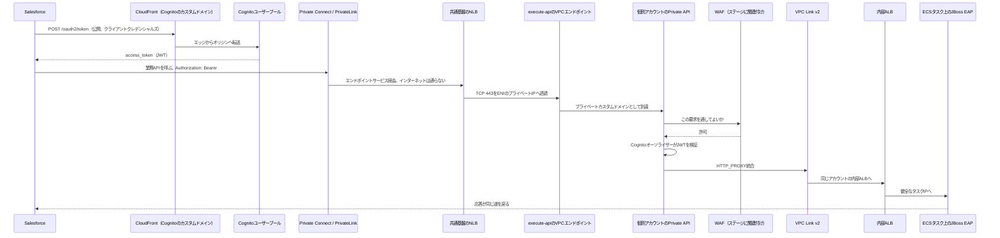

# Salesforce から JBoss EAP までの通信経路

基準日: 2026-10-04

この資料は、次の道筋を一つの絵として説明する。

1. Salesforce が、カスタムドメインの CloudFront 経由で Amazon Cognito ユーザープールから、機械同士（M2M）のアクセストークンを受け取る。
2. そのトークンを持って、Salesforce Private Connect（実体は AWS PrivateLink）に入る。
3. 共通基盤アカウントのエンドポイントサービスと NLB を通り、個別アカウントのプライベート API Gateway に着く。
4. API Gateway に紐づいた WAF と Cognito オーソライザーを通る。
5. VPC Link v2 で同じアカウントの内部 ALB に渡り、ECS サービスのタスクで動く JBoss EAP の REST コントローラが応答する。

Excel 版は同じ内容を表にしたもので、ファイル名は `SalesforceからJBossまでの通信経路_解説.xlsx`。物語として読むときはこの Markdown、項目を引くときは Excel を使う。

この資料は、対象環境の構築ログを採取した記録ではない。Salesforce と AWS の公開ドキュメントを、2026-10-04 時点で読み合わせた設計解説である。証明書のホスト名など、組織の設定で最終確認するものは、そのつど「試験で確定する」と書いた。

---

## 1. 最初に持つ絵

この通信は、一本のパイプではない。続けて行う、性質の違う二つの旅である。

| | 旅A: 通行手形をもらう | 旅B: 通行手形を見せて API を呼ぶ |
| --- | --- | --- |
| 目的 | 短い時間だけ有効なアクセストークンを受け取る | 業務 API を呼び出し、JSON などの応答を受け取る |
| 通り道 | 公開のインターネット。入口はカスタムドメイン。実体は Cognito が用意する CloudFront | インターネットに出ない専用通路。Salesforce Private Connect |
| 終着点 | Cognito ユーザープールのトークンエンドポイント | 個別アカウントの VPC の中の JBoss EAP |
| 守るもの | クライアント ID とクライアントシークレット | 業務データと、さっきもらったトークン |

たとえで言うと、旅Aは「校門の外の窓口で、今日一日だけ使える通行手形をもらう」。旅Bは「その手形を握って、地下通路から職員室の奥の担当者まで行く」。窓口は世界中の人に開いている。地下通路は、あらかじめつないだ相手にしか開かない。

手形の窓口を地下通路の中に置かないのには、理由がある。Cognito のトークンエンドポイントは、もともと公開の OAuth 2.0 の窓口として作られている。カスタムドメインを付けると、AWS が CloudFront の配布を自動で用意し、世界のエッジで TLS を終端する。一方、業務 API は顧客データや取引を扱うので、公開の URL としては置かない。Private Connect は、その業務 API のためにある。

2026年夏から、Cognito にはドメインなしでトークンを発行する `GetClientToken` という AWS API もある。これは VPC エンドポイントと WAF に載る。今回の説明は、依頼どおり「カスタムドメインの CloudFront から `/oauth2/token` でもらう」道を本線にする。新しい API は、後から選べる別口として第11章に書いた。

---

## 2. 小学生にもわかるたとえ

登場人物を、学校の中の役割に置きかえる。

| たとえ | 本物 | ひとことで |
| --- | --- | --- |
| 校庭にいる係の先生 | Salesforce | 用事があるたびに、外の仕組みへ頼む |
| 正式な表札 | カスタムドメイン（例: `auth.example.com`） | 「この学校の窓口です」と示す名前 |
| 世界中にいる門番 | CloudFront のエッジ | 近い場所で出迎え、奥の窓口へ取り次ぐ |
| 通行手形を作る窓口 | Cognito ユーザープール | 合言葉が正しければ、短い時間だけ使える手形を渡す |
| 手形 | アクセストークン（JWT） | 「だれが、いつまで、どの扉を開けてよいか」が書いてある札 |
| 地下通路 | Private Connect / PrivateLink | 校庭の外の公道を歩かずに、相手の建物へ筒でつながる |
| 地下通路の受付 | 共通基盤アカウントの NLB | 筒の先。手紙の中身は読まず、空いている私書箱へ渡す |
| 私書箱 | execute-api の VPC エンドポイント | 「API Gateway さんへ」の専用ポスト。プライベート IP を持つ |
| 奥の担当者 | 個別アカウントのプライベート API Gateway | 手形を確かめ、危ない手紙を返し、残った手紙を社内へ運ぶ |
| 手紙の検査係 | AWS WAF | 担当者の机の横にいる。ネットワークの途中に別の箱があるわけではない |
| 社内の廊下 | VPC Link v2 | API Gateway から、自分の VPC の中へ入る AWS 管理の通路 |
| 階の案内板 | 内部 ALB | HTTP を読み、空いている作業机を選ぶ |
| 作業机 | ECS タスク | JBoss EAP が乗っているコンテナ。机ごとに自分の IP を持つ |
| 机の上の係 | JAX-RS の REST コントローラ | URL とメソッドを見て、注文参照などの仕事をして返事を書く |

旅の順番はこうなる。

1. 先生は、表札のついた窓口へ行き、合言葉を言う。
2. 近い門番が取り次ぎ、窓口が通行手形を渡す。
3. 先生は手形をポケットに入れる。
4. 先生は公道には出ず、地下通路の受付へ行く。
5. 受付は手紙を私書箱に入れる。
6. 奥の担当者が手形を見て、検査係に見せ、大丈夫なら廊下を渡る。
7. 案内板が空いている机を選び、机の上の係が返事を書く。
8. 返事は、来た道を逆に戻って先生の手に届く。

このたとえで外してはいけない点が三つある。

- 門番（CloudFront）は、地下通路の入口ではない。手形を配る窓口の前にいる。
- 受付（NLB）は、手紙の文面を読んで振り分けない。空いている私書箱へ、筒ごと渡す。
- 検査係（WAF）は、廊下に置いた別の機械ではない。奥の担当者（API Gateway）が「この手紙を通してよいか」と尋ねる相手である。

---

## 3. 旅A: トークンをもらう

### 3.1 子どもの説明

先生は「auth.example.com の窓口」へ、合言葉を書いた紙を出す。世界のどこか近い門番が受け取り、奥の Cognito に渡す。合言葉が正しければ、通行手形が返る。手形には有効期限がある。期限が切れたら、もう一度窓口へ行く。

### 3.2 実際のリクエスト

Salesforce 側では、公開側の Named Credential と External Credential を使う。クライアントシークレットは Apex のソースに書かず、External Credential の秘密として置く。

DNS は次のように解決する。

1. 自分が所有するドメイン、たとえば `auth.example.com` を Cognito のカスタムドメインに登録する。
2. 証明書は AWS Certificate Manager で、必ず米国東部（バージニア北部、`us-east-1`）に置く。CloudFront がこの地域の証明書だけを使う、という昔からの約束がある。
3. Cognito が CloudFront の配布を自分で作る。利用者が CloudFront を一から組み立てる必要はない。
4. DNS のエイリアス、または CNAME を、Cognito が表示するターゲット（`dxxxx.cloudfront.net`）へ向ける。
5. 状態が Active になってから、トークン URL を使う。

呼び出しは HTTPS の POST である。

```http
POST /oauth2/token HTTP/1.1
Host: auth.example.com
Content-Type: application/x-www-form-urlencoded
Authorization: Basic BASE64(client_id:client_secret)

grant_type=client_credentials&scope=orders-api%2Fread
```

成功すると、だいたい次の JSON が返る。

```json
{
  "access_token": "eyJraWQiOiJ...長いJWT...",
  "token_use": "access",
  "expires_in": 3600,
  "token_type": "Bearer"
}
```

クライアントクレデンシャルズでは、ID トークンもリフレッシュトークンも返らない。返るのはアクセストークンだけである。有効期限はアプリクライアントの設定で変わり、例として 1 時間が多い。期限の少し前に取り直す。

### 3.3 エッジで何が起きるか

Salesforce の公開コールアウトは、Hyperforce からインターネットへ出る。`auth.example.com` は CloudFront のエッジへ名前解決される。

エッジでは次の順で仕事が進む。

1. TCP でつながる。
2. TLS の ClientHello に、SNI として `auth.example.com` が入る。
3. エッジは、その名前に合う証明書を提示する。証明書は `us-east-1` の ACM 証明書で、Cognito が自分の CloudFront に取り付けている。
4. HTTP の中身を、Cognito ユーザープールのオリジンへ、AWS のネットワークの中で転送する。
5. Cognito がアプリクライアントを確認する。クライアントシークレット、許可された OAuth フローに `client_credentials` があること、頼んだスコープがそのクライアントに許されていること、を見る。
6. 問題がなければ JWT を署名して返す。

カスタムドメインを付けても、トークンの発行者（`iss`）はカスタムドメインにならない。`iss` は次の形のままである。

```text
https://cognito-idp.<リージョン>.amazonaws.com/<リージョン>_<プールID>
```

API Gateway の Cognito オーソライザーはユーザープールを直接知っているので、このままで検証できる。JBoss 側で自分でも JWT を検証する場合は、カスタムドメインを発行者だと思わず、この `cognito-idp` の URL を発行者として検証する。

### 3.4 トークンの中身

アクセストークンは JWT である。ピリオドで三つに分かれた文字列で、ヘッダー、ペイロード、署名が入っている。中身のペイロードは、秘密の暗号化箱ではない。署名付きの公開のメモである。だから、トークンの中に顧客の秘密やクライアントシークレットを入れない。

M2M のペイロードには、だいたい次の主張が入る。

| 主張 | 意味 |
| --- | --- |
| `token_use` | `access`。この札は API へ入るためのものである |
| `client_id` | どのアプリクライアントがもらったか |
| `sub` | M2M ではクライアント ID と同じになることが多い |
| `scope` | 空白区切りの許可範囲。例: `orders-api/read` |
| `iss` | 発行したユーザープールの URL |
| `exp` | 失効時刻（UNIX 秒） |
| `iat` | 発行時刻 |
| `jti` | このトークン一枚ごとの ID |
| `version` | トークン形式の版 |

Essentials または Plus の機能プランでは、2025年3月以降、プリトークン生成 Lambda のイベント版 v3 で、M2M のスコープやクレームを発行直前に調整できる。2025年4月30日以降は、トークン要求に `aws_client_metadata` を添え、その文脈を Lambda で読める。開発用と本番用でアプリクライアントを増やす代わりに、同じクライアントへ文脈を渡す使い方がある。

検証する側は、署名、`iss`、`exp`、`token_use`、`client_id`、そしてメソッドに設定した OAuth スコープを見る。署名の公開鍵は、ユーザープールの JWKS（`/.well-known/jwks.json`）から取る。オーソライザーはその鍵をキャッシュする。

### 3.5 この旅が必要になった理由

機械が人の画面なしで API を呼ぶとき、毎回ユーザー名とパスワードを送る形は似合わない。OAuth 2.0 のクライアントクレデンシャルズは、そのために昔からある約束である。「この機械は、このクライアント ID である」とシークレットで証明し、アクセストークンだけをもらう。

Cognito ユーザープールは、2016年頃から人のサインイン基盤として広まった。同じプールのアプリクライアントに、リソースサーバーとカスタムスコープを足すと、人のログインと機械の認可を一つの発行元にまとめられる。2024年5月9日に M2M の料金が明示され、2025年11月3日には「アプリクライアントの個数への課金」が外れ、成功したトークン要求の回数に寄った。無料利用枠は、M2M のトークン要求には付かない、と料金説明にある。単価は変わるので、最新の料金ページを見る。

カスタムドメインと CloudFront が付いたのは、「amazoncognito.com の長いホスト名を、自社の表札にしたい」という理由と、「TLS 証明書とエッジでの受け付けを AWS に任せたい」という理由である。利用者が独自の CloudFront を前に置く構成も作れるが、Cognito のカスタムドメインそのものが、すでに AWS 管理の CloudFront である。

---

## 4. 旅B: トークンを持って API を呼ぶ

### 4.1 子どもの説明

先生は通行手形を手紙にクリップし、地下通路へ入る。公道は歩かない。通路の先の受付は、手紙を読まずに私書箱へ入れる。奥の担当者が手形と検査を済ませ、社内の廊下を通り、案内板が空いている机を選ぶ。机の上の係が仕事をして、返事を書く。返事は同じ通路を戻る。

### 4.2 全体の順

番号は、Salesforce の Apex コールアウトが JBoss のメソッドに届くまでの順である。

| 順 | 区間 | ここで起きること |
| --- | --- | --- |
| 1 | Apex / Flow → Named Credential | `callout:Private_API/v1/orders` のように論理名で呼ぶ。URL の実体と、Private Connect の紐づけは Named Credential が持つ |
| 2 | Salesforce 管理 VPC | Hyperforce 上の Salesforce 管理 VPC に、お客のエンドポイントサービスへ向かうインターフェイスエンドポイントがある |
| 3 | PrivateLink | そのエンドポイントのプライベート IP から、AWS の背骨を通って、共通基盤アカウントの NLB へ届く。インターネットゲートウェイも NAT もお客の VPN も通らない |
| 4 | エンドポイントサービス | 共通基盤アカウントが公開したサービス。許可されたプリンシパルに、Salesforce が提示する IAM ロールが入っている |
| 5 | NLB | 内部向け。複数 AZ。リスナーは TCP 443 の透過が、この絵では本線。宛先は execute-api VPC エンドポイントの ENI のプライベート IP |
| 6 | execute-api の VPC エンドポイント | サービス名 `com.amazonaws.<リージョン>.execute-api`。API Gateway という AWS サービスへの専用口 |
| 7 | プライベート REST API | 個別アカウント。リソースポリシーが、共通基盤の VPC エンドポイント ID からの `execute-api:Invoke` を許す |
| 8 | プライベートカスタムドメイン | 例: `api.example.com`。ACM の証明書は API と同じリージョン。ドメイン名アクセス関連付けで、共通基盤の VPC エンドポイントと結び、必要なら RAM でアカウント間共有する |
| 9 | WAF | リージョナルな Web ACL を、REST API のステージに関連付ける。拒否ならここで応答が戻り、統合には進まない |
| 10 | Cognito オーソライザー | JWT の署名と期限とスコープをユーザープールで検証する |
| 11 | VPC Link v2 | 同じ個別アカウントの中に、API Gateway が管理する ENI を作る。統合タイプは `HTTP_PROXY`、接続タイプは `VPC_LINK`、統合ターゲットは内部 ALB の ARN |
| 12 | 内部 ALB | HTTP を読む。リスナールールでターゲットグループを選ぶ。ヘルスチェックに合格したタスク IP だけへ渡す |
| 13 | ECS サービス | 望む台数のタスクを保つ。ネットワークモードは `awsvpc`。ターゲットグループのタイプは `ip` |
| 14 | JBoss EAP | Undertow が待受ける。RESTEasy が `@Path` と HTTP メソッドに合うリソースメソッドを呼ぶ |

応答は 14 から 1 へ、同じ接続を戻る。

### 4.3 Private Connect の動作原理

Salesforce Private Connect は、Hyperforce の Salesforce と、お客の VPC を、AWS PrivateLink でつなぐ追加ライセンスの機能である。2020年夏（Summer '20）に使えるようになった。方向は二つある。

| 方向 | だれが呼び始めるか | Salesforce 側に要るもの | AWS 側に要るもの |
| --- | --- | --- | --- |
| インバウンド | AWS 上の仕組みが Salesforce API を呼ぶ | My Domain | VPC、VPC エンドポイント、Route 53 |
| アウトバウンド | Salesforce が AWS 上のサービスを呼ぶ | Named Credential | VPC と VPC エンドポイントサービス（前段は NLB） |

今回使うのはアウトバウンドである。手順の骨子は次のとおり。

1. Private Connect の設定画面で、対象リージョンの IAM ロールを控える。
2. 共通基盤アカウントのエンドポイントサービスの「許可されたプリンシパル」に、その IAM ロールを入れる。
3. サービス名（`com.amazonaws.vpce.<リージョン>.vpce-svc-...`）を Salesforce に登録し、アウトバウンド接続を作る。
4. 準備ができたらプロビジョンする。状態が使えるようになるまで、数分見る。
5. Named Credential の Outbound Network Connection に、その接続を入れる。種別は `PrivateEndpoint` になる。
6. この Named Credential を使うコールアウトは、公開のインターネットではなく、そのプライベート接続へ送られる。

対応する Salesforce の機能には、Apex コールアウト、External Services、外部オブジェクト、Platform Events、Change Data Capture、CRM Analytics、Agentforce の外部サービス型アクションなどがある。ライセンスは、方向ごとに「プロビジョン済み接続 1 本」が基本で、初期のデータ量の目安は 1 時間あたり 225 MB、繰り越しはない。組織あたりの上限は方向ごとに 1,000 接続、という説明が 2026 年の考慮事項にある。太い応答を何度も返す API は、この時間あたりの量を先に見積もる。

インバウンドはポート 443 だけ、という制約がドキュメントにある。アウトバウンドは、ターゲットのポートが標準と違うときは URL にポートを書く。

リージョンは揃える。Hyperforce 上の組織がいるリージョン、Private Connect のリージョン、エンドポイントサービス、プライベート API、ALB、ECS は同じリージョンに置く。PrivateLink はリージョンの中のサービスである。

### 4.4 なぜ受付が NLB なのか

AWS PrivateLink の「サービスを提供する側」は、2017年の登場以来、前段に Network Load Balancer を置く。2026年の VPC ドキュメントでも、提供者は VPC の中に NLB を作り、それをエンドポイントサービスに選ぶ、と説明されている。アプリケーションロードバランサーを、エンドポイントサービスの直接の前段にはできない。

NLB はレイヤー 4 である。TCP の接続を、健全な宛先のどれかへ渡す。HTTP の URL も、JWT も、WAF のルールも、NLB は見ない。見るのは、届いた接続をどのターゲット IP へ運ぶか、である。

だから共通基盤の NLB のターゲットには、「API Gateway そのもの」を登録するのではない。API Gateway はこちらの VPC の中に ENI を生やすサービスではない。代わりに、共通基盤 VPC へ `execute-api` のインターフェイスエンドポイントを作り、その ENI のプライベート IP を、NLB の IP ターゲットとして登録する。NLB から見ると、宛先は「同じ VPC にいる、443 番で待ち受けている数枚のネットワークインターフェース」である。その先で AWS が API Gateway のサービスへ運ぶ。

この形にすると、個別アカウントのプライベート API は、リソースポリシーの条件 `aws:SourceVpce` に共通基盤の VPC エンドポイント ID を書くだけで、アカウントをまたいで受けられる。VPC ピアリングや Transit Gateway で個別 VPC までパケットを運ぶ必要はない。execute-api のエンドポイントは、「どのアカウントのプライベート API でも、ポリシーが許せば同じ口から届く」ように作られている。

### 4.5 ホスト名と証明書

ここが、この構成でいちばん静かに失敗するところである。

Salesforce のコールアウトは、接続先の証明書を検証する。ホスト名は証明書の CN または SAN と一致する。信頼する認証局は、組織の `cacerts.jsp` に載っている公開の認証局である。プライベート CA で自分だけが信じている証明書は、その一覧に無いので拒否される。

一方、公式のアウトバウンド手順は、Named Credential の URL に「エンドポイントサービスの DNS 名」を入れる、と書いている。その名前は `vpce-svc-....vpce.amazonaws.com` のような、AWS が所有する名前である。自分が所有していない名前では、公開の認証局から証明書を発行してもらえない。ACM の公開証明書も同じである。

したがって、次の二つを同時に裸で満たすのは難しい。

- URL のホスト名が、AWS 所有の `vpce.amazonaws.com` である
- そのホスト名が、Salesforce が信頼する公開 CA の証明書に載っている

実装で取る本線は、次の分担である。

- パケットの行き先は、Outbound Network Connection がプライベート接続へ固定する。公開 DNS の A レコードをインターネット越しに追いかけて NLB へ行く、という意味ではない。
- TLS の SNI と HTTP の Host、そして証明書の SAN は、自分が所有する名前に揃える。例: `api.example.com`。
- その証明書は、API と同じリージョンの ACM 公開証明書にし、API Gateway のプライベートカスタムドメインに取り付ける。
- NLB のリスナーは TCP 443 の透過にする。TLS を NLB で終わらせない。Salesforce が見る証明書は、奥の API Gateway が提示する `api.example.com` の証明書になる。
- 個別アカウントのプライベートカスタムドメインを、RAM で共通基盤アカウントへ共有する。共通基盤の execute-api VPC エンドポイントとの間に、ドメイン名アクセス関連付けを作る。関連付けの反映には最大で 15 分程度見る、とドキュメントにある。
- カスタムドメインのポリシーと、API のリソースポリシーの両方で、その VPC エンドポイントを許可する。

このホスト名の最終形は、サンドボックスの組織で実際にコールアウトして確定する。公式手順の文言と、証明書の制約が噛み合うかを、机上だけで断定しない。

NLB で TLS を終端する形も技術的にはある。ただし NLB は、終端したあとに Host や SNI を別の名前へ書き換える装置ではない。奥の API Gateway が期待する名前と、Salesforce が検証する名前が同じである必要がある。透過の方が、その条件を一台分の証明書で満たしやすい。

### 4.6 プライベート API Gateway が判断すること

パケットが execute-api の口から API Gateway に入ったあと、判断はおおよそ次の順で進む。

1. TLS。プライベート API の既定のセキュリティポリシーは TLS 1.2 である。2025年9月系統の `SecurityPolicy_TLS13_...` を、リージョナル API とプライベート API に選べる。
2. どの API か。プライベートカスタムドメインとベースパスマッピング、または API ID と Host ヘッダーで決まる。`x-apigw-api-id` ヘッダーで API を指定する呼び方もある。カスタムドメインと VPC エンドポイントの関連付けがあると、そのヘッダーなしでカスタムドメインのまま呼べる。
3. リソースポリシー。`aws:SourceVpce` が許可リストに無い VPC エンドポイントは、ここで拒否される。
4. WAF。ステージに関連付いたリージョナル Web ACL が、リクエストを許可、拒否、またはカウントする。拒否されたリクエストは統合へ進まない。
5. Cognito オーソライザー。メソッドの認可にユーザープールを指定し、メソッドの OAuth スコープに `orders-api/read` のように必要なスコープを書く。スコープをメソッドに書いて初めて、トークンの `scope` が足りない呼び出しを拒否できる。
6. 使用量プランやスロットリングを付けていれば、その枠も見る。
7. 統合リクエスト。VPC Link v2 経由の `HTTP_PROXY` として、ALB へ渡す。

WAF はケーブルの途中に挿したファイアウォール箱ではない。API Gateway のステージに結び付いた検査である。関連付けのリソース ARN は、REST API では次の形である。

```text
arn:aws:apigateway:<リージョン>::/restapis/<API ID>/stages/<ステージ名>
```

Web ACL はリージョナルスコープにする。CloudFront 用のグローバルスコープの Web ACL は、このプライベート API には付かない。

プライベート API は VPC の中からしか届かないので、公開 API と同じ気持ちで WAF が必須、とまでは言えない。今回のように、共通基盤の口を複数の呼び出し元が共有し、ヘッダー、本文、レート、既知の悪い入力をステージで落としたいときは、ステージに Web ACL を付ける意味がある。レート基準のルールを「送信元 IP」だけで作ると、PrivateLink の向こうでは送信元が数個の内部アドレスに見えることがある。Salesforce の公開出口 IP を想定したルールは、この旅Bでは効かない。クライアント ID や、独自ヘッダーと組み合わせて枠を切る。

### 4.7 VPC Link v2 と ALB

2025年11月21日に、REST API のプライベート統合が Application Load Balancer を直接ターゲットにできるようになった。使う通路が VPC Link v2 である。それより前、REST API の VPC Link v1 は NLB にしかつながなかった。ALB の前に、もう一台 NLB を置く重なりが定番だった。

VPC Link v2 は、HTTP API の時代（2020年頃）に先に生まれ、2025年11月に REST API へ広がった、と見ると歴史がつながる。新しい REST のプライベート統合では v2 を使う。v1 は残っているが、新規の本線にはしない。

制約ははっきりしている。

- API、VPC Link v2、ターゲットのロードバランサーは、同じ AWS アカウントの所有である。
- 対応リージョンと AZ は、API Gateway のドキュメントの一覧に従う。東京リージョンは、2025年11月の発表文の対応一覧に含まれている。
- 作成は `apigatewayv2` の `create-vpc-link` で行い、サブネットとセキュリティグループを渡す。API Gateway が、そのサブネットに自分の ENI を置く。状態は `PENDING` から `AVAILABLE` へ変わる。
- 統合は `HTTP_PROXY`、`connectionType` は `VPC_LINK`、`connectionId` は VPC Link v2 の ID、`integrationTarget` は ALB の ARN である。
- `uri` に書いたホストは、統合先への Host ヘッダーとして使われる。ALB のリスナールールが Host を見ているときは、ここを合わせる。

この「同じアカウント」という制約が、アカウント分割の形を決めている。

- 共通基盤アカウント: Salesforce との玄関。エンドポイントサービス、NLB、execute-api の VPC エンドポイント。
- 個別アカウント: 業務の家。プライベート API、WAF の関連付け、VPC Link v2、内部 ALB、ECS、JBoss。

共通基盤の NLB と、個別アカウントの ALB は、役割が違うので両方残る。共通基盤の NLB は PrivateLink の玄関である。個別アカウントの中で、API Gateway と ALB の間にもう一台 NLB を挟む必要は、2025年11月以降の新しい REST 統合にはない。

### 4.8 ALB から ECS タスクへ

内部 ALB は、インターネット向けにしない。リスナーは HTTP、またはタスクまで TLS を延長するなら HTTPS である。多くの構成では、TLS は API Gateway までで終わり、VPC の中は HTTP で ALB とタスクへ渡す。セキュリティグループで「VPC Link のセキュリティグループからしか ALB に入れない」「ALB のセキュリティグループからしかタスクの待受ポートに入れない」と閉じる。

ECS サービスは、タスク定義の望む台数を保つ。`awsvpc` では、タスクごとに ENI とプライベート IP が付く。Fargate ではネットワークモードは `awsvpc` 固定である。ALB のターゲットグループはターゲットタイプ `ip` にし、インスタンス ID では登録しない。ECS サービスが、タスクの開始と停止に合わせてターゲットを登録・解除する。

ALB のヘルスチェックは、JWT を持たない。チェック用のパス（たとえば `/health`）は、認可なしで 200 を返す軽いものにする。業務の REST コントローラの奥でデータベースまで見にいく重いパスを、ヘルスチェックに使わない。

ALB はターゲットへ、`X-Forwarded-For`、`X-Forwarded-Proto`、`X-Forwarded-Port` を付ける。JBoss がクライアントの元 IP をログに残したいときは、このヘッダーの意味を決めてから読む。PrivateLink 越えでは、元の Salesforce 組織の公開 IP が入っているとは期待しない。

### 4.9 JBoss EAP の中

JBoss EAP は、Red Hat のアプリケーションサーバである。中で HTTP を受け持つのは Undertow、REST の実装は RESTEasy である。

版によって Java の世界の名前が違う。

| EAP | 基盤 | REST の API | パッケージの例 |
| --- | --- | --- | --- |
| 7.4 系 | Java EE 8 | JAX-RS 2.1 | `javax.ws.rs` |
| 8.0 / 8.1 系 | Jakarta EE 10 | JAX-RS 3.1 | `jakarta.ws.rs` |

コントローラの見た目は、どちらも「パスとメソッドに結び付いた Java のメソッド」である。

```java
@Path("/v1/orders")
public class OrderResource {

    @GET
    @Path("/{id}")
    @Produces(MediaType.APPLICATION_JSON)
    public Order get(@PathParam("id") String id) {
        return orders.find(id);
    }
}
```

EAP 8 なら import は `jakarta.ws.rs.*`、EAP 7 なら `javax.ws.rs.*` である。コンテナの中のサーバがどちらを積んでいるかで、ソースの世界が決まる。

クラウド上で昔からある落とし穴は、待受アドレスである。JBoss が `127.0.0.1` だけで待ち受けると、同じタスクの中からしか届かない。ALB はタスクの ENI の IP へ届けるので、HTTP リスナーは `0.0.0.0` と待受ポート（よくあるのは 8080）で開く。起動オプションの例は `-Djboss.bind.address=0.0.0.0` である。

EAP を ECS で動かすときは、Red Hat Cloud Access の対象としてサブスクリプションをクラウドへ移せる。クラスタリング（JGroups など）を使う HA プロファイルは、クラウドのネットワークの制約が大きい。REST を ALB の後ろで水平に並べるだけなら、各タスクをステートレスにし、セッションをタスクのメモリに置かない形が合う。ALB はラウンドロビンや最小未処理リクエストでタスクを選ぶので、次の要求が別のタスクに行く前提でコントローラを書く。

要求がメソッドに届くまでのサーバ内部は、次のとおり。

1. Undertow の HTTP リスナーが、ALB からの接続を受ける。
2. デプロイされた WAR（または EAR の中の WAR）のコンテキストルートに入る。
3. RESTEasy が、URL、HTTP メソッド、`Content-Type`、`Accept` からリソースメソッドを一つ選ぶ。
4. パスパラメータや JSON 本文を、Java の引数に変換する。
5. メソッドが `Response` かエンティティを返す。
6. JSON への変換は、登録されたプロバイダ（JSON-B や Jackson）が行う。
7. ステータスコードと本文が Undertow から ALB へ戻り、API Gateway、PrivateLink、Salesforce の順に戻る。

API Gateway のオーソライザーがすでに JWT を検証しているなら、JBoss は「このポートに届く要求は ALB からだけである」ことをセキュリティグループで支えにする。防御を重ねるなら、JBoss でも同じ JWT を検証できる。そのときは `iss` をカスタムドメインにしない、という第3章の注意を守る。検証を二重にする場合、鍵の取得先と時計のずれ（数十秒）を両方で同じ方針にする。

---

## 5. なぜアカウントを分けるのか

たとえで言うと、共通基盤アカウントは「学校全体の通用門」、個別アカウントは「学年ごとの教室棟」である。

通用門を学年ごとに作ると、Salesforce の Private Connect の接続も、許可する IAM ロールも、証明書の玄関も、学年の数だけ増える。接続はライセンスと時間あたりのデータ量を消費する。門を一つにすると、Salesforce から見た地下通路は一本で、奥のどの教室へ届けるかは AWS 側の API Gateway が決める。

教室棟を門と同じアカウントに置かないのは、次の理由である。

- 業務のデプロイ権限と、ネットワークの玄関の権限を分ける。個別システムの担当者が、エンドポイントサービスの許可プリンシパルを誤って消す事故を減らす。
- 個別システムの ALB や ECS を、そのシステムのパイプラインだけで更新できるようにする。
- 監査で「Salesforce とつながる口」と「業務コンテナ」を別のアカウント境界として説明できる。

分けたときに生まれる技術的な接着剤は、次の三つだけに整理できる。

1. 共通基盤の execute-api VPC エンドポイント ID を、個別アカウントの API リソースポリシーで許可する。
2. 個別アカウントのプライベートカスタムドメインを RAM で共有し、共通基盤の VPC エンドポイントとドメイン名アクセス関連付けを作る。
3. VPC Link v2 は個別アカウントの中だけで完結させる。API と ALB をアカウント越しにはつながない。

---

## 6. 一枚のシーケンス



---

## 7. 歴史を一本の物語にする

この構成は、誰かが最初から完成形を描いたものではない。困りごとが起きるたびに、部品が一つずつ足されている。

### 2008年から2016年: 遠い場所へ速く届ける、そして部屋を分ける

2008年11月、CloudFront が登場した。世界の利用者の近くでコンテンツを渡すための辺縁（エッジ）である。当時の相手は Web サイトの画像や動画が中心だった。のちに Cognito のカスタムドメインは、この「近い場所で TLS を受け、オリジンへ取り次ぐ」性質を、認証の窓口に流用する。

2009年、VPC と当時のロードバランサー（のちの Classic Load Balancer）が登場し、クラウドの中に自分のネットワーク部屋を作れるようになった。2014年に ECS、2016年8月に ALB が続いた。ALB は HTTP を理解するので、URL で振り分け、コンテナの死活を HTTP で見られる。ECS のタスクに `awsvpc` で個別の IP を持たせる流れと、ALB の IP ターゲットは、セットで意味を持つ。

2014年に Cognito が発表され、2016年にユーザープールが本格的に使われ始めた。アプリケーションが、ユーザーのパスワードを自分のデータベースに溜め込む負担を、AWS の認証基盤へ出せるようになった。

2015年7月、API Gateway が登場した。バックエンドの前に、「認可、流量制限、公開の玄関」を置くマネージドサービスである。この時点の API は、公開の HTTPS が前提に近い。

### 2017年: 公開しない、という選択が製品になる

2017年9月に NLB が出た。毎秒とても多い TCP 接続を、中身を読まずにさばくロードバランサーである。この「中身を読まない」性質が、あとで PrivateLink の玄関に選ばれる理由になる。TLS のバイト列を壊さずに奥へ渡せるからである。

2017年の re:Invent で AWS PrivateLink が発表された。それまでの VPC 同士の接続は、ピアリングや VPN で「ネットワーク同士を隣り合わせにする」形だった。隣り合わせにすると、相手のネットワークの広い範囲へルートが開く。PrivateLink は考え方を逆にした。提供者は NLB の後ろの「このサービスだけ」を差し出し、利用者は自分の VPC に生えた ENI のプライベート IP へつなぐ。相手の VPC の CIDR を知る必要がない。2017年11月前後には、API Gateway のプライベート統合（VPC Link から NLB へ）と、VPC の中からだけ呼ぶプライベート API が同じ世代の機能として並んだ。

同じ 2017年、Fargate が登場し、ECS のタスクを仮想マシンの管理なしで動かせるようになった。JBoss のような従来のアプリケーションサーバをコンテナに載せ、ALB の後ろに並べる現実味が増した。

### 2019年から2021年: Salesforce が AWS の上に移り、HTTP API が別の VPC Link を得る

2019年の Dreamforce で Hyperforce が語られ、Salesforce の実行基盤を AWS 上の地域へ置いていく方針が明確になった。ファーストパーティの拠点とお客の AWS を VPN だけで結ぶ時代から、「同じ AWS の背骨の上にいる者同士を、PrivateLink で結ぶ」時代へ移る下地ができた。

2020年1月、エンドポイントサービスにプライベート DNS 名を付けられるようになった。2020年夏、Salesforce Private Connect が Summer '20 で一般提供された。インバウンドは「AWS から Salesforce API へ」、アウトバウンドは「Salesforce の Apex などから、お客の NLB の奥へ」である。お客がエンドポイントサービスを作り、Salesforce の IAM ロールを許可プリンシパルに入れる、という今の手順の原型がここにある。

2019年12月に API Gateway の HTTP API が登場し、2020年には HTTP API 向けの VPC Link が ALB、NLB、Cloud Map へつながるようになった。これが今日 VPC Link v2 と呼ぶ系統の始まりである。REST API は、この時点ではまだ NLB 専用の VPC Link v1 のままだった。

2021年9月、NLB のターゲットに ALB を置けるようになった。REST API が ALB を直接呼べない期間のつなぎとして、「API Gateway → VPC Link v1 → NLB → ALB → ECS」という四段が、世界中の構成図に描かれた。

### 2023年から2024年: 検査と名前と時間

2023年、Cognito ユーザープールに AWS WAF を直接関連付けられるようになった。カスタムドメインの CloudFront とは別に、ユーザープール自体を検査対象にできる。同じ 2023年には NLB にもセキュリティグループが付き、玄関の NLB で許可する送信元を書けるようになった。

2024年5月9日、Cognito の M2M に料金が付いた。機械の認可が「ユーザー認証のおまけ」から、数えて設計する機能になった、という合図である。

2024年6月4日、リージョナル REST API とプライベート REST API の統合タイムアウトを、既定の 29 秒より延ばせるようになった。延ばすにはサービスクォータの引き上げが要り、アカウントのスロットル枠と引き替えになることがある。既定値は今も 29 秒である。クォータを上げただけでは各メソッドのタイムアウトは変わらない。メソッドに秒数を書き、API を再デプロイする。Salesforce のコールアウトは既定 10 秒、最大 120 秒なので、API Gateway だけを 120 秒にしても、Salesforce 側の上限が先に来る。

2024年11月21日前後に、二つの大きな名前の機能が揃った。

- Cognito の機能プラン Lite / Essentials / Plus。新規プールの既定は Essentials。アクセストークンのカスタマイズや、のちの M2M の文脈渡しは上のプランに載る。
- API Gateway のプライベートカスタムドメイン。VPC の中だけに存在する `api.example.com` を、ACM 証明書つきでプライベート API に付けられる。アカウントをまたぐときは RAM で共有し、利用者側の VPC エンドポイントとドメイン名アクセス関連付けを作る。

このプライベートカスタムドメインが、Salesforce の証明書検証と、アカウントをまたぐプライベート API を、同じホスト名でつなぐ接着剤になる。

### 2025年から2026年: REST がついに ALB へ直接届く

2025年3月、M2M のアクセストークンをプリトークン生成 Lambda で調整できるようになった。2025年4月30日、クライアントメタデータで要求ごとの文脈を渡せるようになった。2025年11月3日、M2M の「アプリクライアント個数」への課金が外れ、成功したトークン要求への課金に寄った。

2025年には HTTP API への WAF 関連付けも加わった。今回の本線は REST のプライベート API なので、使うのは従来からある「REST のステージへのリージョナル Web ACL」である。HTTP API の WAF は、将来 HTTP API へ作り変えるときの話である。

2025年11月19日前後、REST API のレスポンスストリーミングが登場した。ストリーミング時は応答時間の上限が大きくなり、プライベートエンドポイントではアイドル 5 分という別の制約がある。通常の JSON の同期呼び出しは、従来の統合タイムアウトの世界のままである。

2025年11月21日、REST API が VPC Link v2 で内部 ALB へ直接つながった。統合タイムアウトを縮め、NLB 一台分の料金と運用を減らし、ALB の HTTP ヘルスチェックとパスルーティングを、REST のまま使える。今回の絵の「個別アカウントの中に NLB を挟まない」は、この日付以降の構成である。

2026年夏、`GetClientToken` が加わった。ユーザープールドメインなしで、クライアント ID とシークレットから M2M のアクセストークンを発行できる。AWS SDK、CLI、API から呼び、WAF とインターフェイス VPC エンドポイントに対応する、と発表されている。ドメイン付きの `/oauth2/token` は残る。今回の本線はカスタムドメインの CloudFront である。トークン取得までインターネットに出したくない、という次の要求が出たときに、この API が候補になる。

JBoss 側の同じ時期の変化は、Jakarta への移行である。EAP 8 は Jakarta EE 10 で、パッケージが `javax` から `jakarta` に変わった。ロードバランサーや VPC の話とは独立だが、コントローラのソースとコンテナの EAP の版が揃っていないと、デプロイした瞬間にクラスが見つからない。

---

## 8. 各部品は「何を見て、何を見ないか」

| 部品 | 見るもの | 見ないもの |
| --- | --- | --- |
| CloudFront（Cognito 管理） | カスタムドメインの TLS、HTTP の転送 | 業務 API の認可。JWT の中身の業務判断 |
| Cognito | クライアントシークレット、許可フロー、スコープ。署名してトークンを発行 | プライベート API までのネットワーク |
| Private Connect | どの Named Credential を、どのエンドポイントサービスへ運ぶか | HTTP の URL の意味。JWT の真偽 |
| NLB | 接続を、健全なターゲット IP のどれへ渡すか | URL、JSON、JWT、WAF ルール |
| execute-api VPC エンドポイント | 「API Gateway というサービスへの私有の口」であること | どの Java メソッドが仕事をするか |
| プライベート API Gateway | リソースポリシー、ステージ、オーソライザー、統合先 | JBoss の内部スレッド |
| WAF | メソッド、パス、ヘッダー、本文、レートなどのルール | データベースの業務ルール |
| Cognito オーソライザー | JWT の署名、発行者、期限、トークン種別、クライアント、メソッドのスコープ | リクエストがどの ECS タスクに着くか |
| VPC Link v2 | API Gateway から、指定した ALB へ私有で届けること | 業務の振り分けルールそのもの |
| ALB | Host、パス、ヘルスチェック、ターゲットの健全性 | Salesforce の組織 ID |
| ECS サービス | 望む台数、ローリング配置、ターゲットの登録 | OAuth の仕様 |
| JBoss の REST コントローラ | URL、メソッド、本文、必要なら再度のトークン検証、業務ルール | CloudFront のエッジの所在 |

「だれかが全部を見ている」箇所は無い。各段が自分の層だけを見るので、障害のときにログを見る場所も分かれる。

---

## 9. セキュリティグループと経路の閉じ方

旅Bのパケットは、次の輪だけを通る。

| 輪 | 受け入れる相手 |
| --- | --- |
| 共通基盤 NLB | エンドポイントサービス経由の PrivateLink。NLB のセキュリティグループを使う場合は、その受付に必要な送信元だけを書く。NLB にセキュリティグループを付けられるのは 2023年以降である |
| execute-api のエンドポイント ENI | 共通基盤 NLB のノード、または NLB のセキュリティグループからの TCP 443 |
| 個別アカウントの ALB | VPC Link v2 に付けたセキュリティグループからの、リスナーポートだけ |
| ECS タスク | ALB のセキュリティグループからの、JBoss の待受ポートだけ |

タスクと ALB にパブリック IP は要らない。この旅のためには、インターネットゲートウェイへの経路も要らない。タスクから別の社内システムやデータベースへ行く経路は、その相手に合わせて別途用意する。

旅Aだけは公開の出口を使う。Salesforce から `auth.example.com` への HTTPS が出られればよい。クライアントシークレットは External Credential に置く。

---

## 10. 時間と大きさの上限

この道には、段ごとの「待てる時間」と「運べる大きさ」がある。いちばん短いものに全体が揃う。

| 場所 | 目安 | メモ |
| --- | --- | --- |
| Salesforce コールアウト | 既定 10 秒、最大 120 秒 | Apex のコールアウトタイムアウト |
| Private Connect の量 | 初期ライセンスで 1 時間あたり 225 MB 程度、繰り越しなし | 方向ごとに別枠。応答の大きさで先に尽きることがある |
| API Gateway の統合タイムアウト | 既定 29 秒 | リージョナルとプライベートの REST は、クォータ申請で延長できる。メソッドへの設定と再デプロイが別途要る。スロットル枠と引き替えになることがある |
| API Gateway のペイロード | 同期応答で 10 MB が標準の上限 | ストリーミングモードは別枠。通常の REST コントローラの JSON は 10 MB の世界で設計する |
| JWT の寿命 | アプリクライアントの設定。例として 3600 秒 | 期限切れは 401 になる。Salesforce 側で取り直す |
| JBoss / ALB のアイドル | ALB と Undertow のアイドル設定 | API Gateway より長く待っても、手前が先に切る |
| ドメイン名アクセス関連付け | 効くまで最大 15 分程度 | 共有直後の失敗を、経路障害と決めつけない |

JBoss の処理が 40 秒かかるなら、API Gateway の既定の 29 秒で 504 になる。Salesforce には「タイムアウト」に見える。延長する前に、その API が同期で 40 秒待ってよいかを決める。待ってよい処理なら、プライベート REST に限って統合タイムアウトの引き上げを検討する。待たせたくない処理なら、受付だけ同期で返し、仕事はキューへ置く。

---

## 11. 2024年以前の図との違い

古い設計書と見比べるとき、次の差分がそのまま修正箇所になる。

| 古い図 | 2026-10-04 時点の本線 |
| --- | --- |
| REST API → VPC Link → NLB → ALB → ECS | 個別アカウントの中は、REST API → VPC Link v2 → ALB → ECS。間の NLB は新規には置かない |
| プライベート API に自社ドメインを付けられず、`execute-api` のホスト名と `Host` ヘッダーや `x-apigw-api-id` で呼び分ける | プライベートカスタムドメインと、アカウント間の RAM 共有、ドメイン名アクセス関連付けが使える |
| 統合タイムアウトは 29 秒が上限 | 29 秒が既定。プライベート REST は引き上げできる |
| M2M は機能として存在するが、料金の考え方が今と違う | 2024年5月に料金化、2025年11月にアプリクライアント個数の課金が外れる |
| トークンは必ずユーザープールドメインの `/oauth2/token` | その道は残る。加えて 2026年夏から `GetClientToken` がある |
| Cognito カスタムドメインの CloudFront は、今も AWS が配布を作る | この点は変わっていない。証明書の地域が `us-east-1` である点も変わっていない |

共通基盤アカウントの NLB は、古い図から消えない。消えるのは「個別アカウントの中で、API Gateway と ALB の間に挟んでいた NLB」の方である。

---

## 12. 設計で落ちやすい点

重要度の高いものから書く。

1. **証明書のホスト名と、Named Credential の URL のホスト名を一致させる。** Salesforce は公開 CA の証明書を検証する。`*.vpce.amazonaws.com` 用の公開証明書は発行できない。本線は、所有ドメインのプライベートカスタムドメインと、TCP 透過の NLB である。サンドボックスでコールアウトして確定する。
2. **`iss` はカスタムドメインではない。** 検証ライブラリに `https://auth.example.com` を発行者として登録すると、正しいトークンを拒否する。
3. **OAuth スコープはメソッドに書く。** オーソライザーをユーザープールにしただけでは、スコープ不足のトークンが通ることがある。
4. **VPC Link v2 の API と ALB は同じアカウントに置く。** 共通基盤の ALB を、個別アカウントの API から直接の統合ターゲットにはしない。
5. **NLB のターゲットは execute-api の ENI の IP である。** API ID をターゲットグループに登録する場所は無い。ENI は作り直しで IP が変わりうるので、登録を追従させる運用（Lambda やコントローラ）を決める。
6. **ヘルスチェックに JWT が要るパスを使わない。** NLB から VPC エンドポイントへは TCP 443 が堅い。ALB から JBoss へは、認可不要の軽い HTTP パスを使う。
7. **JBoss の bind は 0.0.0.0 である。** ループバックだけだと ALB から見て異常になる。
8. **ターゲットタイプは ip である。** `awsvpc` のタスクはインスタンスターゲットに乗らない。
9. **WAF の送信元 IP ルールを、Salesforce の公開出口 IP で書かない。** 旅Bの送信元は PrivateLink 側の内部アドレスに見える。
10. **Private Connect の時間あたりデータ量を見積もる。** 125 MB の応答を 1 時間に数回返すと、初期枠に届く。
11. **29 秒を超える処理は、既定の API Gateway では 504 になる。** Salesforce の最大 120 秒と、API Gateway の既定 29 秒の、短い方で切れる。
12. **時計のずれとトークンキャッシュ。** オーソライザーの結果キャッシュ TTL を、トークン寿命より無思慮に長くしない。期限切れトークンがキャッシュの間だけ通る、という事故を避ける。
13. **リージョンを混ぜない。** 組織の Hyperforce リージョンと、エンドポイントサービスと、プライベート API は同じリージョンにする。Cognito のカスタムドメイン用証明書だけは、例外として `us-east-1` に置く。API 用の証明書は API のリージョンに置く。二つの ACM 証明書を取り違えない。
14. **クライアントシークレットを Apex に埋め込まない。** External Credential に置く。ローテーション手順を先に決める。
15. **EAP の版と `javax` / `jakarta` を揃える。** インフラが通っても、デプロイした WAR の世界が違うとコントローラは起動しない。

---

## 13. 障害のときに見る場所

症状から、最初に開く場所を決める。

| 症状 | 最初に疑う段 | 見にいくもの |
| --- | --- | --- |
| トークン URL が名前解決できない | 旅Aの DNS | `auth.example.com` が Cognito の CloudFront ターゲットを向いているか。ドメインの状態が Active か |
| トークン要求が 401 | Cognito のアプリクライアント | シークレット、`client_credentials` の許可、スコープの綴り |
| トークンは取れるが API が名前や TLS で失敗する | 証明書と Host | Named Credential のホスト名、提示されている証明書の SAN、Salesforce の信頼 CA |
| Private Connect の接続が使えない | アウトバウンド接続 | プロビジョン状態、許可プリンシパルの IAM ロール、リージョン、サービス名の取り違え |
| NLB のターゲットが unhealthy | execute-api の ENI | IP の登録が古くないか。セキュリティグループが NLB から 443 を許可しているか。ヘルスチェックが HTTPS ホスト名検証で落ちていないか |
| API が 403 で本文が拒否 | リソースポリシーか WAF | `aws:SourceVpce`、カスタムドメインのポリシー、WAF のサンプルリクエスト |
| API が 401 | オーソライザー | `Authorization` ヘッダー、`exp`、`iss`、メソッドの OAuth スコープ |
| API が 504 | 時間 | JBoss の処理時間、API Gateway の統合タイムアウト、Salesforce のコールアウトタイムアウト。どの段が先に切ったか |
| API が 503 や ALB の 502/503 | ターゲット | ECS の実行中タスク数、ALB ターゲットのヘルス、JBoss の bind アドレス、アプリの起動ログ |
| ときどきだけ失敗する | 単一 AZ か偏り | NLB、VPC エンドポイント、ALB、ECS が複数 AZ に散っているか。片方の AZ の ENI だけが古い IP のまま残っていないか |
| 急に量で失敗する | Private Connect の時間枠 | その時間のアウトバウンド使用量 |

ログの置き場所も分かれる。Salesforce の Apex 例外、NLB のアクセスではなくメトリクス（NLB は HTTP を見ないので URL のアクセスログは無い）、API Gateway の実行ログとアクセスログ、WAF のログ、ALB のアクセスログ、ECS のコンテナログ（JBoss の `server.log`）である。一つのログに全区間は出ない。

---

## 14. エンドツーエンドの具体例

注文を 1 件読む、という一つの要求で、中身を固定して見る。

前提の名前は説明用である。

- Cognito カスタムドメイン: `auth.example.com`
- アプリクライアント ID: `1example23456789`
- スコープ: `orders-api/read`
- プライベートカスタムドメイン: `api.example.com`
- ステージ: `prod`
- JBoss のコンテキスト: `/orders-app`
- リソース: `GET /v1/orders/1001`

旅Aの本文は次のとおり。

```text
grant_type=client_credentials&scope=orders-api%2Fread
```

返った `access_token` を、旅Bのヘッダーに付ける。

```http
GET /prod/v1/orders/1001 HTTP/1.1
Host: api.example.com
Authorization: Bearer eyJraWQiOiJ...
Accept: application/json
```

Salesforce の Named Credential がベース URL `https://api.example.com/prod` を持ち、Apex が `/v1/orders/1001` を足す、という分け方でも同じである。Outbound Network Connection が付いているので、この HTTPS は公開 DNS のインターネット経路ではなく、プロビジョン済みのエンドポイントサービスへ向かう。

共通基盤の NLB は、この TLS バイト列を execute-api の ENI へ渡す。API Gateway は SNI と Host の `api.example.com` からプライベートカスタムドメインを見つけ、ベースパス `/prod` からステージ `prod` を見つける。リソースポリシーが VPC エンドポイントを許し、WAF がパスとヘッダーを許し、オーソライザーがトークンの `orders-api/read` をメソッドのスコープと照合する。

統合の URI が ALB 側のホストとパスを組む。例として、ALB の後ろのアプリケーションが `/orders-app/v1/orders/1001` で待っているなら、統合のパスマッピングでそこへ書き換える。書き換えた結果が JBoss の `@Path("/v1/orders")` と `@Path("/{id}")` に一致する。メソッドが注文 1001 の JSON を返し、その JSON が同じ接続を Salesforce の `HttpResponse` まで戻る。

この例で、CloudFront を通るのは旅Aの `POST /oauth2/token` だけである。`GET /v1/orders/1001` は CloudFront を通らない。

---

## 15. 用語

| 用語 | 小学生向け | もう一段正確に |
| --- | --- | --- |
| M2M | 人と人ではなく、仕組みと仕組みの合言葉 | OAuth 2.0 のクライアントクレデンシャルズグラント。ユーザーのログイン画面を出さない |
| アクセストークン | 短い時間だけ使える通行手形 | 署名付き JWT。API へ入る許可を表す。秘密の暗号化箱ではない |
| カスタムドメイン | 自分の表札 | 所有ドメインをサービスに付け、証明書の名前と URL の名前を揃える |
| エッジ | 世界中の門番 | CloudFront の POP。近い場所で TLS を受け、オリジンへ転送する |
| VPC | クラウドの中の自分の校舎 | リージョンの中に作る、論理的に隔離されたネットワーク |
| PrivateLink | 校舎同士をネットワークごと隣り合わせにせず、一つの窓口だけを私有 IP で差し出す仕組み | インターフェイスエンドポイントとエンドポイントサービス。提供側の前段は NLB |
| Private Connect | Salesforce がその PrivateLink を、設定画面とライセンスで使えるようにしたもの | インバウンドとアウトバウンドがある。今回はアウトバウンド |
| エンドポイントサービス | 「この NLB の奥を、許可した相手だけに貸します」という看板 | サービス名は `com.amazonaws.vpce.<region>.vpce-svc-...` |
| ENI | ネットワークの差し込み口 | Elastic Network Interface。プライベート IP が付く |
| NLB | 手紙を読まない受付 | L4 ロードバランサー。TCP/UDP をターゲットへ渡す |
| ALB | 手紙の宛名を読む案内板 | L7 ロードバランサー。Host、パス、HTTP ヘルスチェックを扱える |
| プライベート API | 校舎の中からしか呼べない API | エンドポイントタイプ `PRIVATE`。execute-api の VPC エンドポイント経由でのみ呼び出せる |
| リソースポリシー | 「この口からの手紙なら受け取る」という貼り紙 | `execute-api:Invoke` を `aws:SourceVpce` などで条件付き許可する |
| WAF | 担当者の横にいる検査係 | ステージに関連付く Web ACL。ネットワークホップとして数えない |
| VPC Link v2 | API Gateway から自分の VPC へ入る、AWS 管理の廊下 | ENI をサブネットに置き、ALB または NLB へプライベート統合する。REST から ALB へ直接は 2025-11-21 以降 |
| awsvpc | 机ごとに自分のネットワーク口が付く置き方 | タスクごとに ENI。ターゲットタイプは `ip` |
| JAX-RS | URL と Java のメソッドを結び付ける約束 | EAP 7 は `javax.ws.rs`、EAP 8 は `jakarta.ws.rs`。実装は RESTEasy |
| 共通基盤アカウント | 学校全体の通用門を管理するアカウント | エンドポイントサービス、NLB、共有の execute-api VPC エンドポイントを置く |
| 個別アカウント | 学年の教室棟 | プライベート API、VPC Link v2、ALB、ECS、JBoss を置く |

---

## 16. 根拠にした一次情報

日付は、2026-10-04 に確認した公開ページの更新日または発表日である。仕様は更新される。構築直前にもう一度、同じページの該当節を見る。

- Salesforce Help, *Secure Cross-Cloud Integrations with Private Connect*（更新 2026-09-25 前後）
- Salesforce Help, *Establish an Outbound Connection with AWS*（更新 2026-10-02 前後）。許可プリンシパル、サービス名、Named Credential の `OutboundNetworkConnection`、ホスト名と証明書の一致、URL とポート
- Salesforce Help, *Considerations for Private Connect with AWS*（更新 2026-10-02 前後）。ライセンス、時間あたりのデータ量、対応機能
- Salesforce Help, *Make a Private Connection with Named Credentials*（Winter のリリースノート系）
- Amazon VPC, *Share your services through AWS PrivateLink*。提供者は NLB を前段にする、という説明
- Amazon API Gateway, *Set up VPC links V2*（ドキュメント更新 2026-10-03 前後）。同じアカウントであること、ENI を管理すること
- Amazon API Gateway, *Set up a private integration*。REST の `HTTP_PROXY`、`VPC_LINK`、`integrationTarget` に ALB ARN
- AWS What's New, 2025-11-21, *REST APIs now support private integration with Application Load Balancer*
- AWS Compute Blog, 2025-11-21, *Build scalable REST APIs using Amazon API Gateway private integration with Application Load Balancer*
- AWS Whitepaper, *Best Practices for Designing Amazon API Gateway Private APIs and Private Integration*（2026-10 前後の版）。VPC Link v2 を推奨、v1 はレガシー、同じアカウント制約
- Amazon API Gateway, *Custom domain names for private APIs*、*Working with cross-account private custom domain names*。RAM 共有とドメイン名アクセス関連付け。反映まで最大 15 分
- AWS What's New, 2024-06-04, *API Gateway integration timeout limit increase beyond 29 seconds*。対象はリージョナル REST とプライベート REST
- AWS What's New, 2025-11 前後, API Gateway のレスポンスストリーミング
- Amazon Cognito, *Configuring a user pool domain* と *Using your own domain for managed login*。カスタムドメインは Cognito が CloudFront を作り、証明書は `us-east-1`
- Amazon Cognito, *The token issuer endpoint*。クライアントクレデンシャルズはアクセストークンを返す
- AWS What's New, 2024-05-09, Cognito M2M の料金
- AWS What's New, 2024-11-22 前後, Cognito の Essentials / Plus
- AWS What's New, 2025-04-30, M2M のコンテキスト（ClientMetadata）
- AWS What's New, 2025-11-03, M2M のアプリクライアント課金の廃止
- Amazon Cognito ドキュメント履歴, 2026-07 末前後, `GetClientToken`。発表記事は 2026-08-31
- Amazon ECS, *Allocate a network interface for an Amazon ECS task*。`awsvpc` とターゲットタイプ `ip`
- Red Hat, *Deploying JBoss EAP on Amazon Web Services*（EAP 8.0 / 8.1 / 7.4）。Cloud Access と、クラウド上の待受
- Red Hat Customer Portal, *JBoss EAP Supported Standards*。EAP 8 系は Jakarta EE 10、JAX-RS 3.1。EAP 7.4 は Java EE 8、JAX-RS 2.1

---

## 17. Excel の読み方

`SalesforceからJBossまでの通信経路_解説.xlsx` は、この物語を表にしたものである。フォントはすべてのセルで Meiryo UI、色は白から黒までの無彩色だけを使っている。

| シート | 用途 |
| --- | --- |
| 00_読み方 | 資料の約束、二つの旅、色の意味 |
| 01_全体像 | 旅Aと旅Bを横に並べた一枚 |
| 02_たとえ話 | 学校のたとえと本物の対応 |
| 03_通信手順 | 番号順の区間。子ども向けと仕組みを同じ行に置いた |
| 04_登場人物 | 各部品が何を見て、何を見ないか |
| 05_歴史 | 年と、そのとき困っていたこと |
| 06_動作原理 | DNS、TLS、PrivateLink、JWT、VPC Link、Undertow |
| 07_トークン | 要求、応答、クレーム、だれが検証するか |
| 08_アカウント | 共通基盤と個別アカウントの境界 |
| 09_注意点 | 落ちやすい点と、確認の仕方 |
| 10_障害の見方 | 症状から最初に開く場所 |
| 11_用語 | 短い定義 |
| 12_根拠 | 一次情報と、机上では確定しない点 |

印刷は A3 横。各シートの見出し行は固定してある。フィルタで「旅」や「重要度」を絞れるシートがある。
